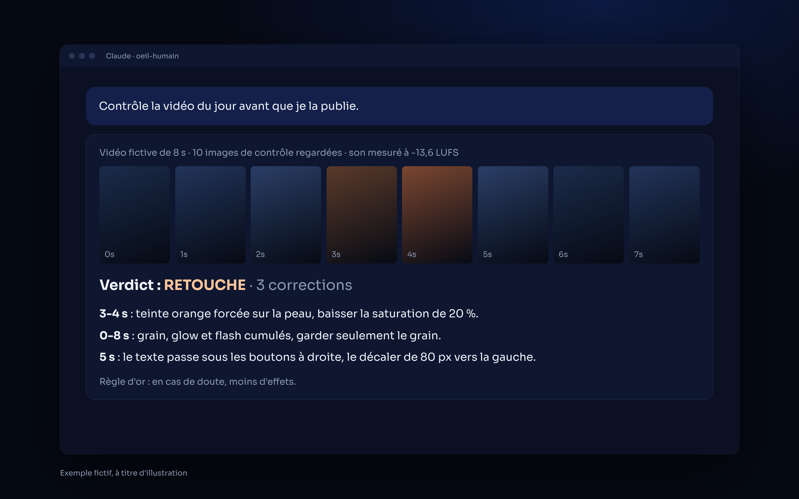
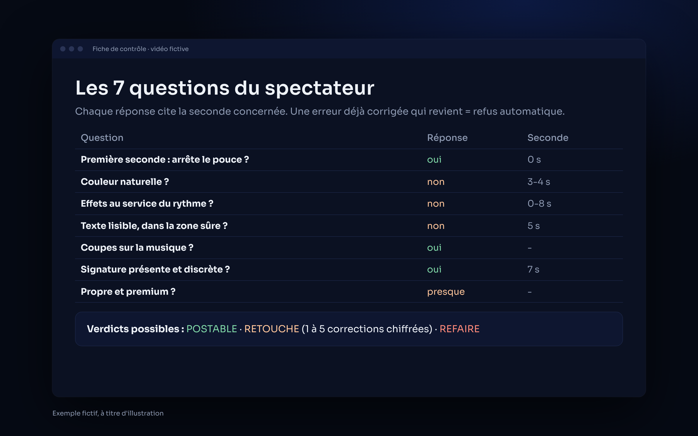

<p align="center">
  
</p>

<p align="center">
  
  
  
</p>

# Oeil Humain — le regard du spectateur avant de publier

**Un skill Claude qui regarde ta vidéo montée comme un spectateur exigeant de 18-25 ans qui scrolle : trop retouchée, filtres agressifs, effets en trop, texte illisible. Verdict clair avant publication.**
*A Claude skill that reviews an edited short video like a real viewer would, before you post it.*

## ✦ Ce que fait le skill

| | |
|---|---|
| **Images de contrôle** | Une image par seconde, la première et la dernière, plus une planche contact. Claude les regarde toutes. |
| **Son mesuré** | Niveau sonore mesuré (cible -14 LUFS, sauf règle de ta chaîne). |
| **7 questions** | Première seconde, couleur, effets, texte et zone sûre, rythme, signature, impression générale. Chaque réponse cite la seconde concernée. |
| **Verdict** | POSTABLE, RETOUCHE (1 à 5 corrections chiffrées) ou REFAIRE. |
| **Mémoire des erreurs** | Une erreur déjà corrigée qui revient = refus automatique. Une correction qui revient 2 fois va dans le fichier d'erreurs de la chaîne. |
| **Règle d'or** | En cas de doute entre plus d'effet et moins d'effet : moins. |

## ✦ Aperçu

Un contrôle avec verdict RETOUCHE, puis la fiche des 7 questions :

<p align="center">
  
  
</p>

<p align="center"><sub><i>Exemple fictif, à titre d'illustration.</i></sub></p>

## ✦ Installation

**Télécharger** : bouton vert **Code → Download ZIP**, ou :

```bash
git clone https://github.com/horizonchapter/oeil-humain.git
```

**Claude Code** (pour tous tes projets) :

```bash
cp -r oeil-humain/skills/oeil-humain ~/.claude/skills/
```

**Claude (app et web)** : importe le fichier [`oeil-humain.zip`](oeil-humain.zip) dans les réglages des skills de Claude.

**Prérequis** : `ffmpeg` installé pour extraire les images et mesurer le son.

## ✦ Utilisation

Après un montage, avant de publier :

- « Contrôle cette vidéo avec oeil-humain. »
- « Est-ce que c'est postable ? »

Le meilleur résultat : le lancer comme sous-agent indépendant, qui n'a pas fait le montage.

## ✦ Structure

```
oeil-humain/
├── skills/oeil-humain/SKILL.md   le skill
├── oeil-humain.zip               le même skill, prêt à importer
├── assets/                       bannière et aperçus
├── CHANGELOG.md · CONTRIBUTING.md · SECURITY.md · LICENSE
└── .github/ISSUE_TEMPLATE/       modèles d'issues
```

## ✦ Voir aussi

- [filtre-ia](https://github.com/horizonchapter/filtre-ia) : le même regard, appliqué aux interfaces.
- [claude-subagents](https://github.com/horizonchapter/claude-subagents) · [checklist-lancement-web](https://github.com/horizonchapter/checklist-lancement-web)

## ✦ Licence

[MIT](LICENSE). Libre d'utilisation, de modification et de partage.
